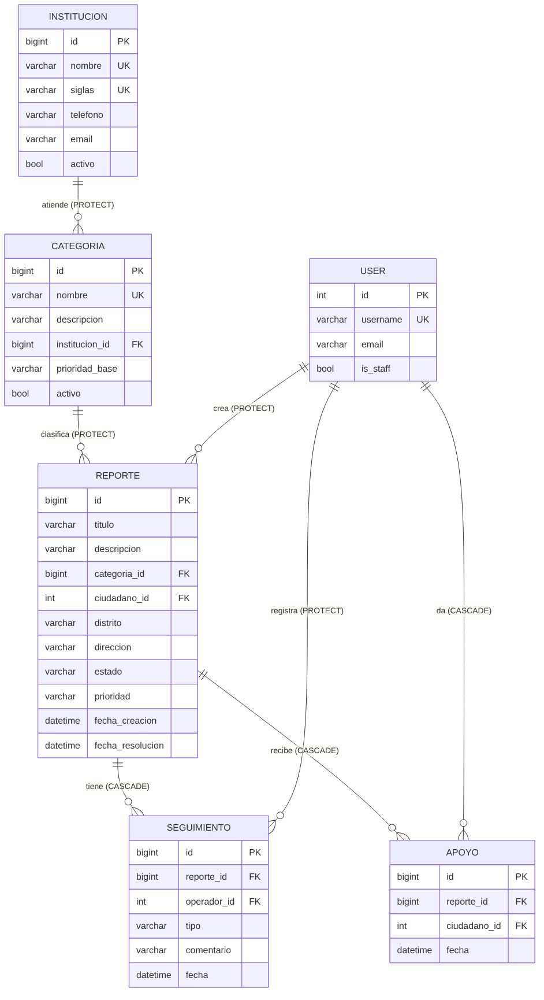
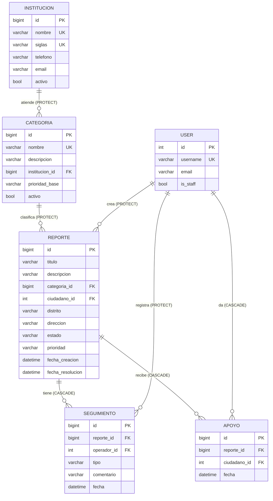

# Documento técnico — Reporte Ciudadano

Universidad de Costa Rica, Sede Regional del Pacífico · Desarrollo de Software IV · Proyecto integrador

## 1. Problema y usuarios

En las comunidades los problemas de servicios públicos (cortes de luz, falta de agua, huecos en la carretera, basura sin recoger) se reportan por teléfono o redes sociales. No queda registro, se duplican los reportes y el ciudadano no sabe si alguien atendió su caso.

**Reporte Ciudadano** centraliza los reportes, los dirige automáticamente a la institución responsable según la categoría, permite que los vecinos afectados apoyen un mismo reporte en lugar de duplicarlo y deja un historial de seguimientos.

| Perfil | Quién es | Qué hace |
|---|---|---|
| Administrador | Usuario `is_staff` (admin) | Gestiona instituciones y categorías, elimina reportes y seguimientos, ve estadísticas |
| Operador | Grupo `Operadores` | Cambia el estado de los reportes y registra seguimientos |
| Ciudadano | Grupo `Ciudadanos` | Crea reportes y apoya los reportes de otros vecinos |
| Anónimo | Sin token | Solo consulta instituciones y categorías |

## 2. Diagrama entidad-relación

**Relaciones:**

- 1:N: Institución → Categoría, Categoría → Reporte, Usuario → Reporte, Reporte → Seguimiento.
- N:M: Usuario ↔ Reporte mediante la tabla intermedia **Apoyo**, con `UniqueConstraint(reporte, ciudadano)`.

**Restricciones únicas:** `Institucion.nombre`, `Institucion.siglas`, `Categoria.nombre` y el par `(reporte, ciudadano)` en Apoyo.

**Políticas de borrado:**

| Relación | Política | Justificación |
|---|---|---|
| Categoría → Institución | PROTECT | No se puede perder qué institución atiende una categoría; se responde 409 |
| Reporte → Categoría | PROTECT | Los reportes históricos deben conservar su categoría; se responde 409 |
| Reporte → Usuario | PROTECT | No se borra un ciudadano que tiene reportes registrados |
| Seguimiento → Reporte | CASCADE | Un seguimiento no tiene sentido sin su reporte |
| Seguimiento → Usuario | PROTECT | Se conserva quién hizo cada avance |
| Apoyo → Reporte / Usuario | CASCADE | El apoyo depende de ambos; si uno desaparece, el apoyo también |

## 3. Módulos: entradas, salidas y relaciones

| Módulo | Entradas | Salidas | Relación con otros módulos |
|---|---|---|---|
| Instituciones | nombre, siglas, teléfono, email, activo | Institución creada o listado paginado | Sus categorías definen a quién llega cada reporte |
| Categorías | nombre, descripción, institución, prioridad_base | Categoría o listado filtrado | Asigna la prioridad inicial del reporte |
| Reportes | título, descripción, categoría, distrito, dirección | Reporte con estado, prioridad y fechas | Recibe seguimientos y apoyos; alimenta las estadísticas |
| Seguimientos | reporte, tipo, comentario | Seguimiento con operador y fecha | Cambia el reporte de RECIBIDO a EN_PROCESO |
| Apoyos | reporte | Apoyo con ciudadano y fecha | Con 3 apoyos sube la prioridad del reporte a ALTA |

## 4. Reglas de negocio

| ID | Regla | Dónde se valida | Respuesta |
|---|---|---|---|
| RN-01 | El nombre y las siglas de la institución son obligatorios y no se repiten (sin importar mayúsculas) | `InstitucionSerializer.validate_nombre` / `validate_siglas` | 400 |
| RN-02 | El nombre de la categoría es único; no se asigna a una institución inactiva | `CategoriaSerializer` | 400 |
| RN-03 | Título obligatorio y descripción de 10 caracteres o más | `ReporteSerializer.validate_titulo` / `validate_descripcion` | 400 |
| RN-04 | No se crea un reporte en una categoría inactiva | `ReporteSerializer.validate_categoria` | 400 |
| RN-05 | Un ciudadano no puede tener dos reportes abiertos de la misma categoría en el mismo distrito; al actualizar se excluye el propio registro | `ReporteSerializer.validate` | 400 |
| RN-06 | Solo se permiten estas transiciones: RECIBIDO→EN_PROCESO/RECHAZADO y EN_PROCESO→RESUELTO/RECHAZADO. Un reporte cerrado no se modifica. Se valida en PUT y PATCH | `ReporteSerializer.validate` | 400 |
| RN-07 | Decisiones automáticas: la prioridad se copia de la categoría y la fecha de resolución se llena al pasar a RESUELTO | `ReporteSerializer.validate` | — |
| RN-08 | El comentario del seguimiento tiene 5 caracteres o más; no hay seguimientos en reportes cerrados (también en PATCH). El primer seguimiento pasa el reporte a EN_PROCESO | `SeguimientoSerializer` / `seguimientos_api` | 400 |
| RN-09 | No se apoya un reporte propio ni uno cerrado | `ApoyoSerializer.validate` | 400 |
| RN-10 | Un ciudadano apoya una sola vez el mismo reporte. Con 3 apoyos la prioridad sube a ALTA | `apoyos_api` + `UniqueConstraint` | 409 |
| RN-11 | No se elimina una institución con categorías ni una categoría con reportes | Vistas de detalle (`ProtectedError`) | 409 |
| RN-12 | El ciudadano dueño del reporte y el operador del seguimiento no se pueden cambiar | `ReporteSerializer` / `SeguimientoSerializer` | 400 |

## 5. Matriz de permisos

| Endpoint | Método | Anónimo | Ciudadano | Operador | Administrador |
|---|---|---|---|---|---|
| /api/instituciones/ y /api/categorias/ | GET | ✅ | ✅ | ✅ | ✅ |
| /api/instituciones/ y /api/categorias/ | POST, PUT, PATCH, DELETE | 401 | 403 | 403 | ✅ (permisos de modelo) |
| /api/reportes/ | GET | 401 | ✅ | ✅ | ✅ |
| /api/reportes/ | POST | 401 | ✅ (grupo + add_reporte) | 403 | 403 (no pertenece a Ciudadanos) |
| /api/reportes/{id}/ | PUT, PATCH | 401 | 403 | ✅ (change_reporte) | ✅ |
| /api/reportes/{id}/ | DELETE | 401 | 403 | 403 | ✅ (IsAdminUser) |
| /api/reportes/mis-reportes/ y /{id}/historial/ | GET | 401 | ✅ | ✅ | ✅ |
| /api/reportes/estadisticas/ | GET | 401 | 403 | 403 | ✅ (IsAdminUser) |
| /api/seguimientos/ | GET | 401 | ✅ | ✅ | ✅ |
| /api/seguimientos/ | POST | 401 | 403 | ✅ (add_seguimiento) | ✅ |
| /api/seguimientos/{id}/ | PUT, PATCH | 401 | 403 | ✅ (change_seguimiento) | ✅ |
| /api/seguimientos/{id}/ | DELETE | 401 | 403 | 403 | ✅ (IsAdminUser) |
| /api/apoyos/ | GET | 401 | ✅ | ✅ | ✅ |
| /api/apoyos/ | POST | 401 | ✅ (grupo + add_apoyo) | 403 | 403 |
| /api/apoyos/{id}/ | DELETE | 401 | ✅ solo los propios (si es ajeno, 403) | 403 | ✅ |
| /api/perfil/ | GET | 401 | ✅ | ✅ | ✅ |

**Grupos y permisos asignados:**

- **Ciudadanos:** `add_reporte`, `view_reporte`, `add_apoyo`, `delete_apoyo`, `view_apoyo`.
- **Operadores:** `view_reporte`, `change_reporte`, `add_seguimiento`, `change_seguimiento`, `view_seguimiento`.

**401 frente a 403:** 401 significa que no se envió token o que el token no es válido (no se sabe quién es el usuario). 403 significa que el usuario se identificó, pero no tiene el permiso o el grupo que pide la operación.

## 6. Consultas ORM no triviales

| # | Consulta | Ubicación | Tipo |
|---|---|---|---|
| 1 | `Reporte.objects.values('estado').annotate(total=Count('id'))` | `estadisticas_api` | Agregación agrupada |
| 2 | `Categoria.objects.annotate(total_reportes=Count('reportes'))` | `estadisticas_api` | Agregación por relación inversa |
| 3 | `Institucion.objects.annotate(reportes_abiertos=Count('categorias__reportes', filter=Q(categorias__reportes__estado__in=[...])))` | `estadisticas_api` | Agregación con filtro a través de dos relaciones |
| 4 | `Reporte.objects.annotate(total_apoyos=Count('apoyos')).order_by('-total_apoyos')[:5]` | `estadisticas_api` | Ranking N:M |
| 5 | `reportes.filter(categoria__institucion_id=...)` | `reportes_api` | Filtro por relación (doble guion bajo) |
| 6 | `Q(titulo__icontains=...) \| Q(descripcion__icontains=...) \| Q(direccion__icontains=...)` | `reportes_api` | Búsqueda con OR |
| 7 | `Reporte.objects.select_related('categoria', 'categoria__institucion', 'ciudadano')` | `reportes_api` | select_related (llaves foráneas) |
| 8 | `Reporte.objects.prefetch_related('seguimientos__operador').annotate(total_apoyos=Count('apoyos'))` | `historial_reporte_api` | prefetch_related (relación inversa) + agregación |
| 9 | `Reporte.objects.filter(...).exclude(estado__in=ESTADOS_CERRADOS).exclude(pk=self.instance.pk)` | `ReporteSerializer.validate` | Validación de duplicados sin bloquear el propio registro |

## 7. Catálogo de endpoints

Todas las rutas terminan en `/`. Los listados paginados devuelven `count`, `next`, `previous` y `results`, con 5 registros por página (`?page=`).

| Método | URL | Descripción | Parámetros / Body | Códigos |
|---|---|---|---|---|
| POST | /api/token/ | Obtener token | `username`, `password` | 200 / 400 |
| GET | /api/perfil/ | Datos y rol del usuario | Token | 200 / 401 |
| GET | /api/instituciones/ | Listar (paginado) | `?activo=`, `?ordering=nombre\|-nombre`, `?page=` | 200 / 400 |
| POST | /api/instituciones/ | Crear | nombre, siglas, telefono, email, activo | 201 / 400 / 401 / 403 |
| GET | /api/instituciones/{id}/ | Detalle | — | 200 / 404 |
| PUT/PATCH | /api/instituciones/{id}/ | Actualizar | Campos de la institución | 200 / 400 / 401 / 403 / 404 |
| DELETE | /api/instituciones/{id}/ | Eliminar | — | 204 / 401 / 403 / 404 / 409 |
| GET | /api/categorias/ | Listar (paginado, filtros combinables) | `?institucion=`, `?prioridad=`, `?activo=`, `?page=` | 200 / 400 |
| POST | /api/categorias/ | Crear | nombre, descripcion, institucion, prioridad_base, activo | 201 / 400 / 401 / 403 |
| GET | /api/categorias/{id}/ | Detalle | — | 200 / 404 |
| PUT/PATCH | /api/categorias/{id}/ | Actualizar | Campos de la categoría | 200 / 400 / 401 / 403 / 404 |
| DELETE | /api/categorias/{id}/ | Eliminar | — | 204 / 401 / 403 / 404 / 409 |
| GET | /api/reportes/ | Listar (paginado, filtros combinables, búsqueda y orden) | `?estado=`, `?prioridad=`, `?distrito=`, `?categoria=`, `?institucion=`, `?buscar=`, `?ordering=`, `?page=` | 200 / 400 / 401 |
| POST | /api/reportes/ | Crear reporte | titulo, descripcion, categoria, distrito, direccion | 201 / 400 / 401 / 403 |
| GET | /api/reportes/{id}/ | Detalle | — | 200 / 401 / 404 |
| PUT/PATCH | /api/reportes/{id}/ | Actualizar o cambiar estado | estado y otros campos | 200 / 400 / 401 / 403 / 404 |
| DELETE | /api/reportes/{id}/ | Eliminar | — | 204 / 401 / 403 / 404 |
| GET | /api/reportes/mis-reportes/ | Reportes del usuario | `?page=` | 200 / 401 |
| GET | /api/reportes/{id}/historial/ | Reporte, seguimientos y apoyos | — | 200 / 401 / 404 |
| GET | /api/reportes/estadisticas/ | Estadísticas | Token de administrador | 200 / 401 / 403 |
| GET | /api/seguimientos/ | Listar (paginado) | `?reporte=`, `?tipo=`, `?page=` | 200 / 400 / 401 |
| POST | /api/seguimientos/ | Registrar | reporte, tipo, comentario | 201 / 400 / 401 / 403 |
| GET | /api/seguimientos/{id}/ | Detalle | — | 200 / 401 / 404 |
| PUT/PATCH | /api/seguimientos/{id}/ | Actualizar | tipo, comentario | 200 / 400 / 401 / 403 / 404 |
| DELETE | /api/seguimientos/{id}/ | Eliminar | — | 204 / 401 / 403 / 404 |
| GET | /api/apoyos/ | Listar | `?reporte=` | 200 / 400 / 401 |
| POST | /api/apoyos/ | Apoyar reporte | reporte | 201 / 400 / 401 / 403 / 409 |
| GET | /api/apoyos/{id}/ | Detalle | — | 200 / 401 / 404 |
| DELETE | /api/apoyos/{id}/ | Retirar apoyo | — | 204 / 401 / 403 / 404 |

**Operación omitida:** Apoyos no tiene PUT ni PATCH porque un apoyo solo relaciona a un ciudadano con un reporte; no tiene datos editables. Para cambiarlo se elimina y se crea de nuevo. Los otros cuatro módulos tienen CRUD completo.

## 8. Uso de códigos HTTP

| Código | Cuándo |
|---|---|
| 200 | Consultas y actualizaciones correctas |
| 201 | Registro creado |
| 204 | Registro eliminado |
| 400 | Datos inválidos o regla de negocio incumplida (JSON con el campo y el mensaje) |
| 401 | Sin token o con token inválido |
| 403 | Con token, pero sin grupo o permiso |
| 404 | El id no existe |
| 409 | Conflicto con datos existentes: apoyo duplicado o eliminación protegida |

## 9. Flujo de una solicitud

Postman envía `POST /api/reportes/` con el token. La **URL** dirige la solicitud a la **vista** `reportes_api`. `TokenAuthentication` identifica al usuario, y `IsAuthenticated` y `ReportePermisos` revisan que pertenezca a Ciudadanos y tenga `add_reporte`. La vista agrega el ciudadano a los datos y se los pasa al **serializer**, que **valida** los campos y las reglas (RN-03 a RN-07). Si todo es válido, `serializer.save()` usa el **modelo** y el **ORM** para insertar el registro en **MySQL**. Por último, la vista devuelve un **Response** con el reporte en JSON y el código 201; si algo falla, devuelve 400 con los errores.
